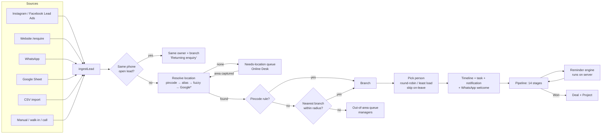
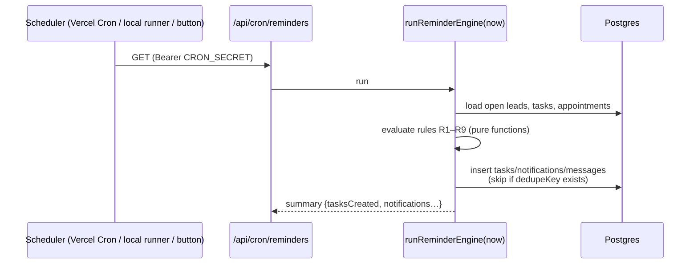
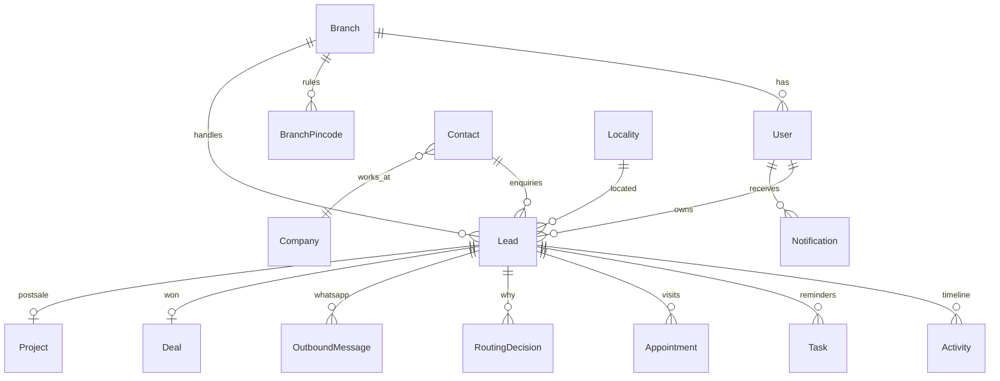

# Elementra CRM — Understanding the Project (Guide for Rana)

> Read this once end to end before the build starts, and again before the client meeting. It explains the client's business, how they work today, what we promised, how the system works inside, and how to answer the hard questions.

---

## 1. The 60-second version

- **Client:** Elementra, a premium modular kitchen / wardrobe / furniture brand with **Experience Centres** (showrooms) in **Worli, Andheri, Tardeo (Mumbai) and Pune**.
- **Problem:** about 60–70 enquiries a month (mostly Instagram ads) land in one Google Sheet. One Online Desk person calls each one, finds out where the site is, and forwards it to a branch. Follow-ups depend on memory, so **a third of leads die as "No response"**.
- **What we sell:** a custom CRM (₹1,49,000, 5 weeks, no GST from us, client pays platforms directly), recommended over Zoho Enterprise.
- **What this milestone is:** a **live demo** on the real codebase (`elementra-crm`, Next.js 16 + Prisma + Postgres) proving the **brain** (location-based routing to the right team and person) and the **robot** (server-side reminders and escalations). Everything else in the package gets a visible screen, honestly labelled.
- **Lead → team transfer** is the "EMS bit": branches are teams, salespeople are employees, and leave, workload and roles affect who gets a lead.

---

## 2. The client's business, in plain words

| Term | Meaning at Elementra |
|---|---|
| Experience Centre | A showroom where customers see finishes and kitchens. Branches: Worli, Andheri, Tardeo, Pune. |
| Online Desk | Central pre-sales person/team. First contact for online leads; qualifies them and hands them to a branch. |
| Handover | Moving a lead from the Online Desk to a branch salesperson (column "Handed Over to" in their sheet). |
| Site | The customer's flat/house where the kitchen goes. **Its location decides the branch.** |
| Possession | When the customer gets the keys. Many leads are months away from possession, so sales cycles are long and need **revive reminders**. |
| Architect / designer | Often influences the purchase and earns a commission (columns "Architect Name", "Architect Commission"). |
| Bare shell | An unfinished flat; the customer needs everything. |
| Ballpark / quotation | A rough estimate first, then a detailed quote after measurement. |
| Token | An advance payment, the step before "Closed Won". |
| Turnkey | Kitchen plus civil work. Usually a bigger ticket. |

**Deal sizes** in their sheet range from **₹8 L to ₹50 L**. That's why one recovered lead justifies the whole CRM.

---

## 3. How they work today: reading their Excel

File: "Elementra – Online Sales Pipeline". Sheets:

### 3.1 `Sales Pipeline` (the main sheet)
Columns: Entry Date · Month (formula) · **Status** (dropdown, 14 stages) · Salutation · First/Last Name · **Site Address** (free text) · Email · Phone · **Branch** (Tardeo/Andheri/Worli/**Online**) · **Elementra Rep** · **Product/Solution** (Kitchen, Wardrobes, Furniture, Appliances, Others, Beds) · Opportunity Name (formula: name_branch_product) · **Order Value (INR)** · Architect Name · Architect Commission · **Source** (dropdown: Instagram Organic, Instagram Paid Media, Reference, Repeat purchase, Whatsapp, Linkedin, Facebook, Google, Walkins, Call) · **Remarks** (the whole history in one cell) · **Handed Over to**.

What the data shows (128 enquiries, 16 Aug – 17 Oct 2026):
- Branch = "Online" for virtually every row, and **one rep owns all of them**. The real branch only appears in "Handed Over to" (Worli 34, Andheri 29, Tardeo 5, Pune 2, one person's name, and **57 blank**).
- Status: No response 44 · Qualified 28 · New 21 · Lost-Others 9 · Quotation Sent 6 · Lost-Budget 6 · Lost-Competitor 6 · Quotation Requested 3 · Negotiations 2 · On Hold 1 · Contacted 1 · **Won 1**.
- Source: Instagram Paid Media 105 (82%); everything else is tiny.
- Remarks look like `4/9 : Did not pick up … 12/9 : Contact her after the festival … 14/10 : <branch rep> to follow up`. These are **manual reminders written as text**, and they're exactly what our reminder engine replaces.
- Data quality: "Instagram Paid Media Paid Media" (a typo value), multiple phones in one cell, `91…` and `(+1)…` formats, misspelt areas ("Borivalli", "Goregoan"), and out-of-area sites (Surat, Hyderabad, Raipur, Chhattisgarh, Ratnagiri, MP).
- About 51 October rows in the copy we received have names and phones blanked out. Don't be surprised by gaps.

### 3.2 `Online Campaign Leads`
This is the raw **Meta Lead Ads export** format: `id (l:…), created_time, ad_id (ag:…), ad_name, adset_id (as:…), adset_name, campaign_id (c:…), campaign_name, form_id (f:…), form_name, is_organic, platform (ig/fb), elementra_bespoke_products_you_are_looking_for (elementra_kitchens), full_name, email, phone_number, lead_status`. Our CSV importer and webhook mapper use this shape.
Key insight: **the form asks no location question**, so every lead needs a phone call before routing. Recommend adding "Site pincode".

### 3.3 `Executive Summary`
Three pivot tables, which we rebuild live on the Reports page:
1. Count of leads by **Status → Product**, columns by **Month**.
2. Count by **Handed Over to** (branch distribution).
3. Sum of **Order Value** by **Branch × Rep**.

### 3.4 `Current Live Projects` (hidden, empty)
Their planned post-sale tracker: Site name/address, **Site Designer, Site Supervisor**, Branch, Products, then stage columns: **Re-verify measurement → Civil work → Re-verify for production → Order sent to factory → Material delivered → Installation → Cleaning → Handover**, plus material expected date, expected handover, and **Warranty End = Handover + 60 months**. We prototype this as **Projects (Preview, add-on)**. It's a natural upsell.

---

## 4. What the proposal promised (commercial reference)

Proposal dated **26 Aug 2026**: "A CRM that actually runs your sales desk".

- **Two options compared:** Zoho Enterprise (₹2,49,000 setup to us + ₹1,44,000/yr to Zoho for 5 users, 7–8 weeks) vs **Custom (recommended)**: **₹1,49,000**, **140 hours**, **5 weeks**, no GST from us.
- **Platform bills paid directly by the client:** hosting (~₹1,999/mo typical), domain, Meta WhatsApp messages (≈₹0.12 utility, ≈₹0.86 marketing), Google Maps (often ₹0 at their volume), Sheets/Lead Ads API (₹0). About ₹4,599/month typical.
- **Launch package includes:** all CRM modules (dashboard, leads, contacts, companies, deals, tasks, inbox, campaigns, automations, templates, reports, audit, settings), auto-assign + area rules, one WhatsApp number, one Meta ad account, one Google Sheet, source code handover, start with 5 users and add more freely.
- **Not included:** native iOS/Android apps · many WhatsApp numbers/brands · billing/GST invoices/payment gateway · AI calling/voice bot · cleaning ten years of messy Excel · their ad spend.
- **5-week plan:** Day 1–2 discovery and Rules Sheet · W1 foundation + staging link · W1–2 CRM screens on live data · W2 brain (auto-assign + out-of-area, tested with 20 dummy leads in front of the client) · W3 pipes (WhatsApp API, FB/IG webhook, Sheets) · W4 robot (automations, reminders, dashboard, reports, audit) · W5 import, 90-min training, go-live, 45 days hypercare.
- **Payment:** 40% start (₹59,600) · 40% when testing begins (₹59,600) · 20% at go-live (₹29,800). Extra scope at **₹1,200/hour after written OK**.
- **Out-of-area method recommended:** "Pincode list + Maps location" (best for most Indian SMEs). Our demo implements pincode rules + a local locality map + radius, with Google Maps as the switch-on upgrade.

**Scope guard for you:** Projects tracker, Quotation builder, leave planner/attendance and native apps are **not** in the ₹1,49,000 package. The demo shows them as "Preview / Planned add-on". If the client says "so that's included?", answer: "That's a next-phase item. We prototyped it so you can see the idea, and we'll quote it separately once launch is live."

---

## 5. The system in one picture



\*Google is a stub this milestone; the local map handles the demo.

---

## 6. Key flows, step by step

### 6.1 A lead arrives
1. Any source calls one function, `ingestLead()`.
2. Phone is cleaned to `+91XXXXXXXXXX`. Second numbers become "alt phone".
3. **Duplicate?** If the same phone has an open lead, the new one is linked and goes to the **same salesperson** (continuity), who is notified "Returning enquiry".
4. **Location** is resolved from pincode or text.
5. **Branch** is decided: pincode rule → nearest branch inside its radius → otherwise out of area. No location → Online Desk.
6. **Person** is picked inside the branch: round-robin (oldest "last assigned" first) or least open leads; people on leave are skipped.
7. Everything is written in one transaction: lead, routing decision (with its explanation), timeline entries, first task (due within 1 working hour), audit entry.
8. Then: notification to the person (and a copy to the owner), plus a WhatsApp welcome (simulator).

### 6.2 Lead without a location
The Online Desk sees it in **Queues → Needs location**, with a task "Capture site location". They call, type "Borivalli west", and save. Routing re-runs, the lead **hands over** to Andheri, both people are notified, and the timeline logs `HANDOVER`.

### 6.3 Out of area
The lead is parked in **Queues → Out of area** with the distance to the nearest branch. A manager can **accept for a branch** (it then gets assigned normally), **send the polite regret template**, or **close as Lost – Others**. The settings can make this automatic instead.

### 6.4 Working a lead
The salesperson sees it in **My Day**, calls (tap to call), logs the outcome, and sets the **next follow-up**. Moving through stages happens on the lead page or by dragging on the kanban. Lost requires a reason. On-hold/timeline losses ask for a **revive date**, so the lead comes back by itself.

### 6.5 Showroom visit
"Book showroom visit" creates an appointment. 24 h before, the engine sends the reminder template to the customer and a prep task to the host. Two hours after the slot, if nobody marked Visited/No-show, the host gets a "mark the outcome" task.

### 6.6 Won
Moving to Closed Won (with order value) creates a **Deal** (existing module) and a **Project** (Preview) with the 8 site stages.

---

## 7. The routing engine, explained with real numbers

Branch centroids: Worli (19.0176, 72.8162), Andheri (19.1364, 72.8296), Tardeo (18.9690, 72.8150), Pune (18.5030, 73.8670). Radii: 30 / 30 / 25 / 25 km. Distance = haversine (straight line).

| Input | How it's understood | Decision | Why |
|---|---|---|---|
| "Flat 1802, Worli Sea Face" + 400018 | Pincode → Worli | Worli | 0.0 km |
| "Flat 704, Palm Residency, goregoan east" | Fuzzy → Goregaon East (0.98) | Andheri | 4.4 km (Worli 17.0) |
| "Sector 17, Vashi 400703" | Pincode → Vashi | **Worli by rule** | Andheri is nearer (18.9 vs 20.3) but the rule wins |
| "kandiwali east" | Fuzzy → Kandivali East | Andheri | 8.7 km |
| "Thakur Village" | Alias → Kandivali East | Andheri | 8.7 km (landmark aliases match exactly, before fuzzy) |
| "Chembur" | Alias → Chembur | Worli | 9.7 km (Andheri 12.0) |
| "Thane West" | Alias | Andheri | 18.1 km (Worli 28.1) |
| "Baner, Pune" | Alias | Pune | 10.5 km |
| "New Panvel 410206" | Pincode → Panvel | **Out of area** | 31.8 km from Worli, radius 30 (just outside) |
| "Adajan, Surat" | Alias → Surat | **Out of area** | 226 km |
| "NA" / empty | Nothing | **Needs location** | Online Desk |

**Why the fuzzy matcher compares base names and directions separately:** "Andheri West" and "Andheri East" are 97% similar as strings. Comparing the whole name would mix up the two sides of the railway line, which are different areas. So we fuzzy-match "Andheri" and then apply "east/west" exactly.

**Why not Google Maps right now?** It needs the client's Google Cloud billing account and key. The local map covers ~90 Mumbai/Thane/Navi Mumbai/Pune localities plus common out-of-area cities, which is enough to demo every rule. With the key, unknown addresses get geocoded exactly ("pin on the map"), and results are cached in the database.

**Edge cases you may be asked about:**
- *A customer gives a Mumbai office address but the site is in Pune.* Routing uses **site address**, not where the customer lives. The form label says "Site area / pincode".
- *A branch is closed or the whole team is on leave.* Assignment falls back to the branch manager, else the lead lands in the "Unassigned" queue and the owner is notified.
- *Two branches are equally near.* The nearer one wins by distance. If the client wants a fixed split, use pincode rules.

---

## 8. The reminder engine, explained

**Why server-side matters:** reminders in a browser tab die when the laptop closes. Ours are rows in the database, created by a function that runs on the server on a schedule.



- **Idempotent:** every created item has a `dedupeKey` (e.g., `R1:<leadId>`), so running the engine 100 times creates each reminder once.
- **Working hours:** SLAs count working minutes in IST. A lead at 23:40 gets its welcome message instantly, but the "first call" is due at 11:00 next morning.
- **Vercel limitation:** on Vercel's **Hobby** plan, crons can only run **once a day** (deploys fail otherwise), and timing can be off by up to an hour. For the demo we use the local runner and the "Run now" button. In production either use **Vercel Pro** (every 5 minutes) or a free external pinger (cron-job.org, a GitHub Actions schedule, Upstash QStash) hitting the cron URL with the secret.

**The nine rules (talk about them in business words):**
1. New lead not called in 1 working hour → alert the salesperson.
2. Still not called at 4 hours → alert the branch manager.
3. Follow-up date reached → alert; overdue more than a day → shows in the manager's digest.
4. No activity for X days in a stage (e.g., 3 days after the quotation) → automatic follow-up task.
5. Showroom visit tomorrow → WhatsApp reminder to the customer + prep task for the host.
6. Visit time passed with no outcome marked → "Did they come?" task.
7. 3 unanswered calls → suggest the close-the-loop message (never auto-close).
8. On-hold lead's revive date reached → back to the salesperson.
9. 09:30 daily digest to managers: yesterday's leads, overdue by person.

---

## 9. Code map (Next.js app)

**Stack:** Next.js 16 App Router + React 19 · Prisma 6 + PostgreSQL (Docker locally on **5610**, Neon in prod) · NextAuth v4 credentials + JWT · Tailwind 4 · Vercel (`sin1`). Local app on **4610** (your other projects use 3000).

**How Next.js pieces map to what you know from Spring:**

| Spring Boot idea | Here |
|---|---|
| `@Controller` returning views | **Server Components** (`app/dashboard/**/page.tsx`) query Prisma directly through `lib/data/*` |
| `@PostMapping` form handlers | **Server Actions** (`'use server'` functions in `actions.ts`): validate (zod) → domain → audit → `revalidatePath` |
| `@RestController` for external callers | **Route Handlers** `app/api/**/route.ts` (webhooks, public form, cron, CSV export, notifications polling) |
| Spring Security filter chain | `proxy.ts` (route protection) + `requireUser()/requireRole()` guards inside actions |
| `@Service` classes | Pure functions in `lib/domain/**` (routing, geo, reminders): easy to unit-test with Vitest |
| JPA entities + Flyway | `prisma/schema.prisma` + `prisma migrate dev` |
| `@Scheduled` | `/api/cron/reminders` called by Vercel Cron / local runner |
| `ApplicationEventPublisher` | Not used. `ingestLead()` runs the steps in order; side effects after the transaction commits. |

**Where to look when…**

| You want to change… | File(s) |
|---|---|
| How an address is understood | `lib/domain/geo/normalise.ts`, `resolve.ts`, `Locality` seed |
| Which branch gets a lead | `lib/domain/routing/decide.ts`, Settings → Routing, `BranchPincode` |
| Who inside a branch gets it | `lib/domain/routing/assign.ts`, Team page |
| The whole intake pipeline | `lib/domain/leads/ingest.ts` |
| Reminder rules / thresholds | `lib/domain/reminders/rules.ts`, `engine.ts`, Automations page |
| WhatsApp wording | `MessageTemplate` seed, Settings → Templates |
| Switch simulator → real WhatsApp | `lib/domain/messaging/metaCloud.ts` + env `WHATSAPP_*` |
| Who can see what | `lib/auth/scope.ts` (`leadWhereForUser`), `lib/auth/guards.ts` |
| Feature badges / Build Status | `lib/features.ts` |
| Demo scenarios / seed | `lib/demo/scenarios.ts`, `lib/demo/generate.ts`, `prisma/seed-demo.ts` |

**Data model (simplified):**



---

## 10. Integrations: what "switching on" really needs

| Integration | What's built | What the client must do | What we then do |
|---|---|---|---|
| **Instagram/Facebook Lead Ads** | Webhook route with Meta's verification handshake; mapper for Meta's lead format; CSV importer for exports | Give admin access to Meta Business Manager + the Page; allow our app in the Page's lead access settings | Create the Meta app, request lead-retrieval and page permissions (App Review if Meta asks), subscribe the Page to `leadgen`, set `META_*` env, test with Meta's Lead Ads testing tool. Exact permission names change; check Meta's current docs at switch-on. |
| **WhatsApp Business (Cloud API)** | Templates (EN/HI), rendering, sending flow, outbox with status ticks (simulator) | Company number (not on a personal WhatsApp), Meta business verification (7–21 days), display-name approval | Register the number, submit templates for approval, set `WHATSAPP_*`, add the status/inbound webhook. Note: free-form replies only within 24 h of the customer's last message; outside that, only approved templates. |
| **Google Maps Geocoding** | Provider code behind a flag | Google Cloud project + billing account in their name | Create a key restricted to the Geocoding API, set `GOOGLE_MAPS_API_KEY`, cache results |
| **Google Sheets** | Placeholder + "simulate row" | Share the sheet | Simplest: an Apps Script on the sheet that POSTs new rows to `/api/public/leads` with the API key. Alternative: a service account + scheduled polling. |
| **Website form** | `/enquire` page + `/api/public/leads` | Decide: link/iframe, or their developer posts to our API | Give them the API key and field list |

---

## 11. Running it

```bash
cp .env.example .env              # fill NEXTAUTH_SECRET etc.
npm install
npm run db:up                     # Postgres in Docker on localhost:5610
npm run db:migrate                # create tables
npm run db:seed                   # admin + branches + localities + users + templates + settings
npm run db:seed:demo              # ~180 synthetic leads with live-looking dates
npm run dev:all                   # app on http://localhost:4610 + local reminder runner
# Prisma Studio: npm run db:studio → http://localhost:5611
# Reset before a demo: npm run db:reset
```

Demo logins: `aarav@elementra.test` (owner), `ananya@…` (Online Desk), `kabir@…` (Worli manager), `arjun@…` (Andheri rep), all with password `Demo@1234`, or use the quick-login chips.

**Staging link for the client (recommended before the meeting):**
1. Neon: create a branch/database "staging" (Singapore).
2. Vercel: import the repo, set the env vars (`DATABASE_URL`, `NEXTAUTH_URL` = staging URL, `NEXTAUTH_SECRET`, `DEMO_MODE=true`, `CRON_SECRET`).
3. `DATABASE_URL=… npx prisma migrate deploy`, then `npm run db:seed` and `npm run db:seed:demo` against staging.
4. Keep the `vercel.json` cron at once a day (Hobby).
5. **Warm it up 5 minutes before the meeting.** Neon's free tier sleeps when idle, so the first page load can take a few seconds.

---

## 12. Demo-day checklist

- [ ] `npm run db:reset` within the last hour (so "today" numbers look right)
- [ ] `npm run dev:all` running; the reminder runner shows ticks in the terminal
- [ ] Logged in as Owner; a second browser profile logged in as Andheri rep and Online Desk
- [ ] Phone on the same Wi-Fi, opening `http://<laptop-ip>:4610`, or the staging URL
- [ ] SLA setting back at 60 minutes (if you changed it while rehearsing)
- [ ] Notifications cleared ("mark all read") so new ones stand out
- [ ] **A screen recording of the full demo saved locally,** your backup if anything fails live
- [ ] Build Status page reconciled with Part D of the pitch doc
- [ ] Rules Sheet questions printed or ready to share
- [ ] Laptop: Do Not Disturb on, other tabs closed, zoom 110–125% for readability

---

## 13. Tough questions & good answers

| They ask | You answer |
|---|---|
| "Is this the final product?" | "It's the working core on the real codebase. The brain and reminders are done; integrations switch on with your accounts; the rest is marked on the status page." |
| "Will WhatsApp messages really go to customers?" | "Not yet. It's a simulator so we never message real customers by mistake. Once Meta approves your number and templates, the same flow sends real messages." |
| "How much will Google Maps cost?" | "At about 1,000 leads a month you usually stay inside Google's free monthly quota in India, so it's often ₹0. The bill is in your Google account, not ours." |
| "Can we change the rules ourselves?" | "Yes. Radius, pincode rules, working hours, SLA times and templates are all in Settings. Bigger logic changes are a small job for us." |
| "Can salespeople see each other's leads?" | "No. Salespeople see their own, managers see their branch, the owner sees everything. Every change is in the audit log." |
| "What if someone resigns?" | "Deactivate them, bulk-reassign their open leads in two clicks, and the history stays." |
| "Is our data safe? Where is it?" | "In your own database (Neon, Singapore region) and your own hosting account. You own the code. Access is by login and role, with an audit log." |
| "Can we get a mobile app?" | "It works in the phone browser today, including tap-to-call and tap-to-WhatsApp. Native apps aren't in this package; we can quote them later." |
| "How is this better than Zoho?" | "Zoho needs the Enterprise plan for this, at about ₹1.44 lakh a year forever for 5 users, and scripts that can hit daily limits. This one follows your rules, with no per-user rent, and you own it." |
| "Can it show architect commissions?" | "The architect and commission % are stored on each lead today. A commission report is a small addition." |
| "Can the screens be in Hindi?" | "Customer messages are already in English and Hindi. Screens are in English, as discussed in the proposal; a Hindi interface would be a separate item." |
| "When can we go live?" | "About 2–3 weeks after the Rules Sheet is frozen and Meta approves WhatsApp. That's why we'd like to start the Meta verification this week." |
| "Can it call customers automatically / AI?" | "Not in this package. It's on the 'later' list." |

---

## 13a. If something breaks live

- **Stay calm and narrate.** "This is the staging build. That's exactly why we demo early." Switch to the screen recording for that step.
- **A scenario routes unexpectedly:** open the Routing card and read the explanation. It usually tells you why (e.g., a pincode rule). It's still a good demo of transparency.
- **The page hangs on staging:** Neon cold start. Refresh once.
- **Notifications don't appear:** click "Run now" on Automations; check that `cron:dev` is running.

---

## 14. Working with Claude Code on this repo

- Start with `00_CLAUDE_KICKOFF_PROMPT.md`. Claude will audit the repo first and write `project_docs/IMPLEMENTATION_PLAN.md`. **Read that file before letting it continue past Phase 0.** It's where you'll catch wrong assumptions about the existing Contacts/Companies/Deals code.
- Claude works phase by phase and commits after each one. Between phases, skim the diff, run the app, and try one scenario.
- If Claude's context gets long, start a fresh session with: "Continue the Elementra CRM build. Read `CLAUDE.md`, `project_docs/IMPLEMENTATION_PLAN.md` and `STATUS.md`, then continue from the next unfinished phase."
- **Things to verify yourself** (don't just trust "done"):
  1. `npm test`: routing tests include Vashi (rule beats distance), Panvel (out), "Borivalli" (fuzzy), "Andheri East" vs "West".
  2. No real customer names or phones from the client's sheet appear anywhere (`grep` for a couple of real surnames from the Excel).
  3. Ports: nothing bound to 3000 or 5432.
  4. Run the reminder engine twice and check that no duplicate tasks appear.
  5. Log in as a rep and check that you can't open another rep's lead by URL.

---

## 15. Glossary

| Term | Meaning |
|---|---|
| Routing | Deciding **which branch/team** gets a lead |
| Assignment | Deciding **which person** inside that branch gets it |
| Round-robin | Turn by turn: the person who was assigned longest ago goes next |
| SLA | The promise of how fast something must happen (e.g., first call within 1 working hour) |
| Escalation | Telling the manager when the SLA is missed by a lot |
| Geocoding | Turning an address into map coordinates (lat/lng) |
| Haversine | Formula for straight-line distance between two coordinates on Earth |
| Jaro-Winkler | A string-similarity score (0–1) good at catching typos in short names |
| Pincode rule | A fixed mapping "this pincode belongs to this branch" that overrides distance |
| Webhook | A URL that another service (Meta) calls when something happens (a new lead) |
| WABA / Cloud API | WhatsApp Business Account / Meta's hosted API for sending WhatsApp messages |
| BSP | Business Solution Provider (Wati, AiSensy…), a reseller layer on WhatsApp; we avoid it to save markup |
| Template (WhatsApp) | A pre-approved message format required to message customers outside a 24 h chat window |
| Idempotent | Safe to run many times; the result is the same as running once |
| Server Action | A Next.js function that runs on the server when a form or button is used |
| Route Handler | A Next.js API endpoint (`route.ts`) |
| `proxy.ts` | Next.js 16's request interceptor (formerly `middleware.ts`), used to protect routes |
| Neon | Hosted serverless Postgres (production database) |
| Demo mode | `DEMO_MODE=true`: shows the demo panel, quick logins, reset; must be **off** in real production |
